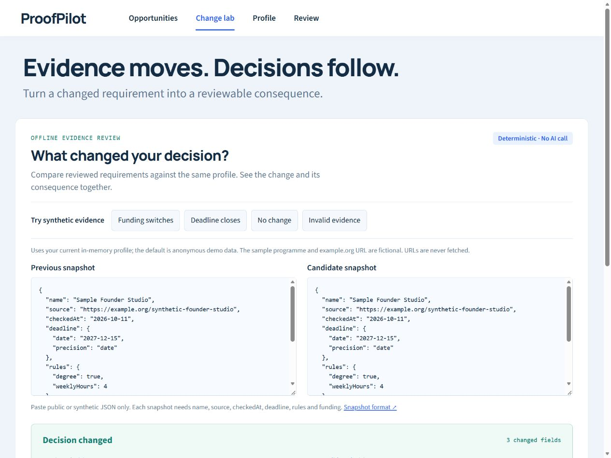
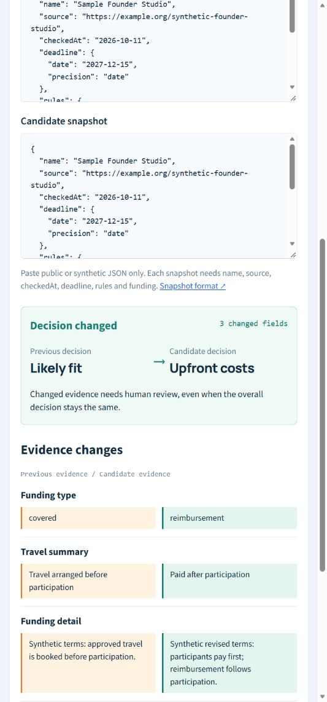

# Change lab

For a founder or developer reviewing public programme requirements: compare two manually reviewed snapshots and see how the changes affect the same profile. This extends ProofPilot's existing rule engine with an offline evidence review workflow. It does not monitor websites or assess source text with AI.

Open **Change lab** in the app. The default example switches fictional travel funding from covered travel to reimbursement. With the anonymous default profile, the decision changes from **Likely fit** to **Upfront costs**. Try the deadline, unchanged and invalid examples, or edit either JSON snapshot. A malformed snapshot produces **Comparison unavailable**, never a no-change result. The copyable Markdown report keeps changed fields, consequences, source URLs and limitations together; raw profile text is omitted.





## Snapshot format

Both inputs use the same strict schema. This example is wholly synthetic. `example.org` is a placeholder, not an organizer source. Replace checked dates with the date you actually reviewed a public source. Future check dates are rejected.

```json
{
  "name": "Sample Founder Studio",
  "source": "https://example.org/synthetic-founder-studio",
  "checkedAt": "2026-10-11",
  "deadline": {"date": "2027-12-15", "precision": "date"},
  "rules": {"degree": true, "weeklyHours": 4},
  "funding": {
    "type": "covered",
    "travel": "Travel arranged before participation",
    "detail": "Synthetic terms: approved travel is booked before participation."
  }
}
```

- All six top-level fields are required. Unknown fields are rejected, including unsupported rules; remove them rather than assuming they were evaluated.
- Field names must occur once per object, even when values match or names use Unicode escapes. **Conflicting fields** demonstrates a later `covered` value hiding an earlier `reimbursement`. Comparison now stops with the input label and both positions. Check the source and keep one field; the app never chooses for you. [Reproduction and limits](ambiguous-input.md).
- Rule fields are optional: `age` (ordered whole-number pair, 0–120), `degree`, `student`, `leadership`, `training` (booleans), `weeklyHours` (1–168), `availability` (short text). Omitted rules are absent checks, not proof of eligibility. Age uses birth-year uncertainty from the existing engine.
- Funding types: `covered`, `conditional`, `project`, `reimbursement`, `none`. Only reimbursement adds the existing upfront-travel check. Descriptive funding prose is displayed/diffed, not semantically interpreted. A changed paragraph always requires human review even if the classification is stable.
- A precise deadline uses `precision: "instant"` and `instant: "2026-10-11T12:00:00+05:00"`, with `date` matching the calendar date in that timestamp. Date-only deadlines must omit `instant`; the engine preserves closing-time uncertainty.
- Source must be HTTPS without credentials, query or fragment; local/literal-IP URLs are rejected. No URL is fetched or independently verified. Different URLs prompt an identity check.
- Inputs are capped at 12,000 characters each and sensitive-text checks reject common credential/email/identity patterns. These checks cannot detect every private detail. Use public or synthetic evidence only.

## Architecture and tradeoffs

`lib/changes.mjs` parses a small explicit schema, compares supported field paths, and evaluates both versions through `lib/engine.mjs` at one fixed instant against one profile. Key ordering is irrelevant. The result distinguishes decision changes, substantive evidence changes, check-date-only changes and identical input. Changed check statuses explain added/removed requirements and funding blockers. `src/components/ChangeLab.jsx` renders editable snapshots, the decision bridge, field differences and a copyable report. Everything runs in browser memory; no new API, persistence, provider request, crawler or telemetry is added.

Strict structured input trades convenience for auditable behavior. It does not extract requirements from prose, validate organizer identity, adjudicate policies or establish that a snapshot is complete. It cannot detect a wrongly labeled funding type; manually check it against the source. A stable result is not approval to ignore changed wording. Data is cleared on reload or when navigating away from the lab; keep your own safe snapshot copies if needed. Clipboard failure leaves the selectable report preview available.

This is a focused complement to established monitoring/evaluation tools, not a claim of novelty. [changedetection.io](https://github.com/dgtlmoon/changedetection.io) and [Distill](https://distill.io/docs/web-monitor/what-is-distill/) already support monitoring and conditions. A [public September 2026 parser-policy report](https://github.com/dgtlmoon/changedetection.io/issues/4385) motivated explicit invalid-evidence handling; it was not reproduced here and no claim is made about their latest release. [Promptfoo](https://www.promptfoo.dev/docs/configuration/expected-outputs/) provides broader output evaluation. Sources inspected October 11, 2026. No implementation was copied from those tools.

## Contributions and license

The portfolio owner requested and scoped the project; this upgrade's implementation, tests, documentation and synthetic fixtures were authored with Codex AI coding assistance. Do not present it as solely unaided human code, proven adoption, a production service or live AI. Project code remains MIT; the existing bundled fonts retain their OFL licenses. The screenshot is of this running interface with synthetic data.
