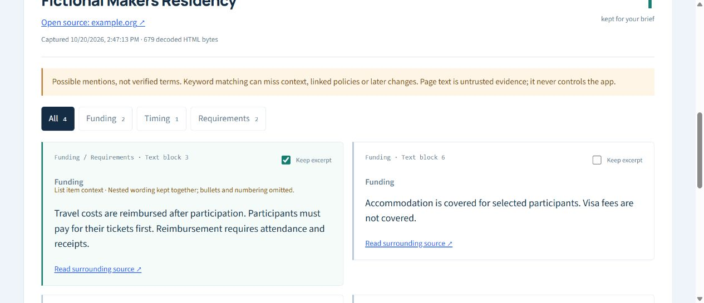

# Keep list conditions with their claims

A public programme page can put a funding claim in a paragraph and its conditions in the enclosing list item. ProofPilot previously skipped that parent and emitted the paragraph alone. This original synthetic reproduction returned just “Travel costs are covered.” and a separate visa excerpt, losing the upfront-payment condition:

```html
<main><h2 id="funding">Funding</h2><ul>
  <li id="travel"><p>Travel costs are covered.</p>
    Only after attendance; participants must buy tickets first.
    <ul><li>Visa fees are not covered.</li></ul>
  </li>
</ul></main>
```

The repaired extractor returns one list-context excerpt:

```text
Travel costs are covered. Only after attendance; participants must buy tickets first. Visa fees are not covered.
```

This repairs an observed local omission. It does not interpret those terms or verify funding.

## Try the working flow

Follow the [local setup](../README.md#run-locally) and use the documented **http://127.0.0.1:5189** port. Choose **Try synthetic example**, then keep the travel excerpt. It includes reimbursement after participation, buying tickets first, and the nested attendance/receipts requirement. Change filters and open **Review selected evidence brief**: the selected item still carries all three conditions and its `#travel` link. Copy works when the browser permits clipboard access; the preview is selectable otherwise.



The normal viewport screenshot is scrolled to the selected excerpt, not a full-page capture. It shows original fictional data, not a fetched organizer page. [Actual synthetic API brief](source-context-demo.md).

## Architecture and limits

The shared inert HTML extractor retains each outermost `li` as one unit and skips its descendants as standalone candidates. An iterative text walk separates block elements and line breaks without splitting inline words such as `reim<strong>bursed</strong>`. Nested lists remain within that unit. List-local headings no longer change the section label of later unrelated paragraphs. UI and Markdown export label list context and explain that numbering, bullets and nesting layout are omitted. The source schema keeps version 1 with additive `context` metadata; absent metadata uses the older generic display.

Privacy heuristics inspect the complete unit before truncation. A contact-looking child omits the whole item, rather than leaving a misleading clean-looking fragment. Existing 700-character, 24-excerpt, 3,000-block and network limits remain. A large outer item can be truncated before a late exception or crowd out granular evidence. Conditions outside it, table/definition/blockquote structures, CSS visibility and linked policies are not solved by this repair. Keyword matching, surrounding anchors and deduplication remain heuristic. No complete-context or semantic-correctness guarantee is made. Nothing becomes an eligibility/funding decision automatically.

No dependencies, background fetches, AI calls, persistence or telemetry were added. Existing MIT code/OFL fonts retain their licenses; all new fixture text and the screenshot are original synthetic material.

## Compared with existing tools

Checked October 20, 2026: [Firecrawl](https://docs.firecrawl.dev/features/scrape#highlights-format) already offers source highlights; [changedetection.io](https://github.com/dgtlmoon/changedetection.io#filters) already supports CSS/XPath extraction and monitoring. Those tools were not tested against this fixture, and this fix makes no claim about their failures or novelty. [WHATWG list-item semantics](https://html.spec.whatwg.org/multipage/grouping-content.html#the-li-element) allow flow content inside items; retaining that unit is a deliberate local tradeoff. Founder/developer usefulness is inferred from fewer detached conditions, not established adoption or user research.

Implementation, tests, synthetic fixtures and documentation were created with Codex AI coding assistance. Ahmad Bilal directed the portfolio project and approved its scope/publication; independent manual authorship, external users, awards and production deployment are not claimed. Optional live local AI remains unverified.
