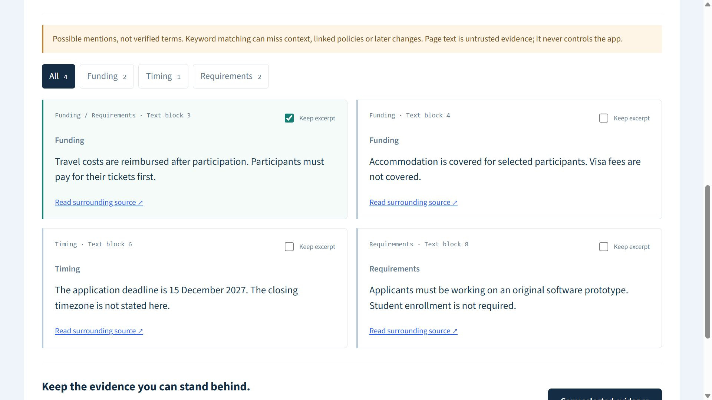

# Source desk

For someone reviewing a programme or founder-support page: collect the actual wording before turning it into structured evidence. Funding descriptions often contain conditions and exclusions. Source desk preserves matched paragraph text and source links rather than interpreting a mention as an award.

## Try it

Run the [local setup](../README.md#run-locally), open Source desk and choose **Try synthetic example**. It makes no external request. Four original fictional excerpts describe reimbursement, uncovered visa fees, a deadline without a stated timezone, and prototype requirements.

1. Select the travel excerpt: its list-item paragraph, upfront-payment condition and nested receipts requirement stay together. A context label explains that bullets/numbering are omitted. See the [October 20 repair](source-context.md).
2. Filter Timing: the deadline remains a possible mention, not a normalized closing instant. Selection survives filters.
3. Copy selected evidence, or expand the selectable brief preview if clipboard access is unavailable. Only checked excerpts enter the brief.
4. For a real public-page read, choose **Use PSF grants URL** and then **Read public page**. The shortcut fills the URL; it does not fetch automatically. This is a documentation example, not an application recommendation or submission.
5. Try `https://127.0.0.1/`: an unavailable state explains the URL restriction. Retry with the synthetic example to recover.

Results disappear on reload or leaving Source desk. No background monitoring, storage, personal telemetry, AI model, account or paid scraping API is used. The website sees a normal GET from the server's network address.

Historical October 18 desktop viewport of the earlier synthetic example, with one travel excerpt selected (before the October 20 list-context label):

[Actual selected synthetic brief](source-desk-demo.md). The screenshot is a viewport capture, not a complete-page rendering or a live organizer page.

## Architecture and tradeoffs

`SourceDesk.jsx` sends only `{url}` to local `POST /api/source`. The server rejects extra payload fields and foreign origins. `public-source.mjs` validates public HTTPS hostnames/DNS, pins the validated address while retaining hostname/TLS checks, revalidates redirects, bounds streamed/compressed content and handles non-HTML/error/timeouts. Source failures return HTTP 422 with an allowlisted `code` (`url`, `dns`, `fetch`, `timeout`, `http`, `content`, `size`, `encoding`, `redirect`); unexpected capture errors return 502 / `source_unavailable`. No raw exception, URL or network stack is echoed. Other request validation errors use their HTTP status and safe message. There is no automatic retry.

`source-evidence.mjs` uses Cheerio's inert buffer parser, removes scripts/forms/common chrome and finds keyword-bearing text blocks. It preserves conditions and negations within retained text; it does not understand them. Ranking reserves category coverage before filling a maximum of 24 excerpts. Outer list items retain their descendant paragraphs and nested list wording as one excerpt; child blocks are not emitted separately. Block boundaries become spaces while inline words remain intact. List numbering, bullets and nesting layout are omitted; the UI/brief label that loss. Contact detection applies to the whole item, so one sensitive-looking child omits the item. Other text blocks retain the prior extraction behavior. Text blocks are whitespace-normalized, duplicates skipped, text over 700 characters explicitly truncated. Long list items may lose a late condition at that bound; read the source. `context` is additive metadata (`list-item` or `text-block`) within source schema version 1; older results without it still render. After 3,000 candidate blocks, scanning stops and a limitation is shown. HTML bytes are hashed after HTTP decompression; the digest identifies the bytes, not their truth, publisher identity or completeness.

`source-brief.mjs` formats only selected IDs, including the page URL and each available section anchor. Anchors may lead to a broader container; they are not exact text citations. The synthetic route runs the same extractor on `data/source-demo.mjs` and labels its mode. The browser does not import the server parser. Existing eligibility, Change lab and offline CLI remain separate; no fetched sentence becomes a structured fact automatically. The CLI remains dependency-free.

Limits: static HTML only; English keyword coverage; no JS execution, PDFs, linked policies, crawling, logins or bot bypass. Some layouts produce no useful blocks. Keyword matches may miss terms or include irrelevant paragraphs. Contact/sensitive-looking blocks are omitted heuristically, not guaranteed confidential-data filtering. A successful read with zero matches is different from a failed read. Page rights remain with their owners: review permission and context before copying or redistributing text. Only original synthetic prose is bundled in this repository/demo.

## Existing solutions and contribution

General extraction already exists: [Firecrawl scraping](https://docs.firecrawl.dev/features/scrape) provides multiple formats, including source highlights, and [changedetection.io](https://github.com/dgtlmoon/changedetection.io) offers monitoring and selectors. Checked October 18, 2026. ProofPilot's narrow addition is a local, profile-free reading/selection flow beside its existing structured evidence tools. This is not a novelty claim or a replacement for those tools; the usefulness of this particular combination is inferred, not established by user research.

Code and synthetic fixtures were developed with Codex AI coding assistance, including completing an inherited unfinished local implementation, review, tests and documentation. Ahmad Bilal directed the portfolio project and approved its scope/publication; this does not establish sole unaided code authorship or independently demonstrated implementation expertise. No adoption, award, organizer endorsement or impact metric is claimed.

## Observed runtime evidence

On October 18, 2026, Windows Node 24.19.0: a real request through the running local API fetched `https://www.python.org/psf/grants/` at `2026-10-18T12:25:26.307Z`, reported 61,747 decompressed HTML bytes, 69 matching blocks, 24 retained excerpts, 3 contact/sensitive-looking blocks omitted and `limited: true`. The browser also showed a public-page result for the same URL. These counts describe one captured response, not a completeness/accuracy score or a guarantee of future access. No real source prose or page snapshot is bundled here.

Synthetic browser selection/copy and invalid-address refusal were observed separately. [Validation and remaining limits](../VALIDATION.md). The optional local AI workflow remains unverified against a live model; Source desk does not use it.
